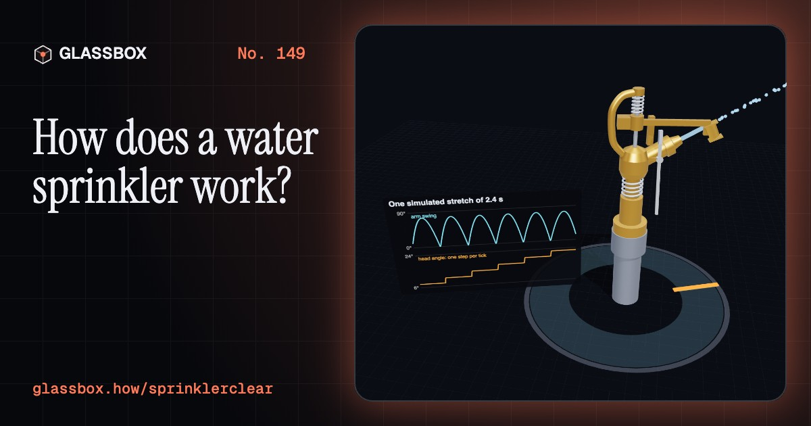
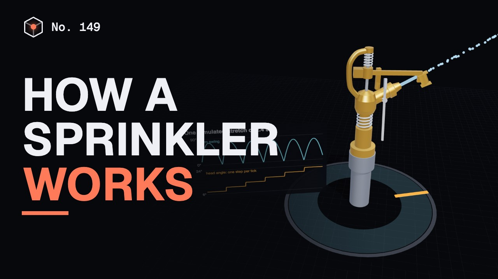
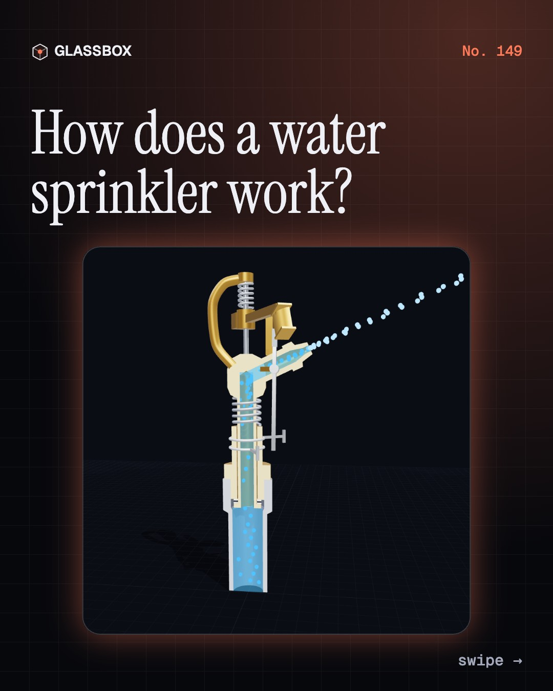
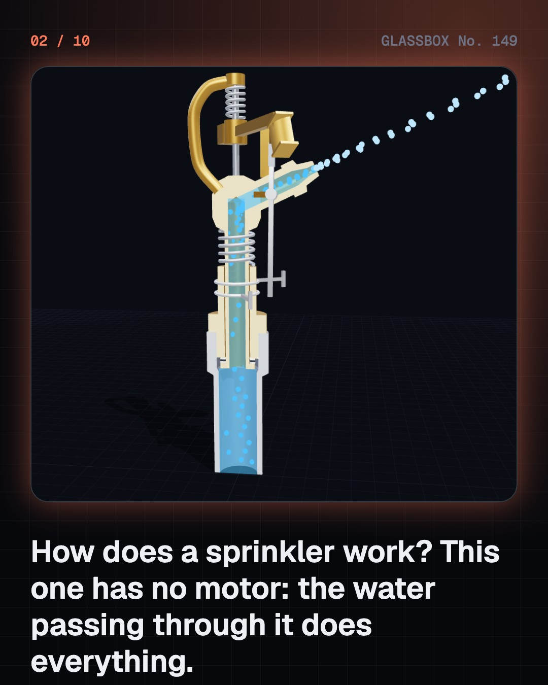
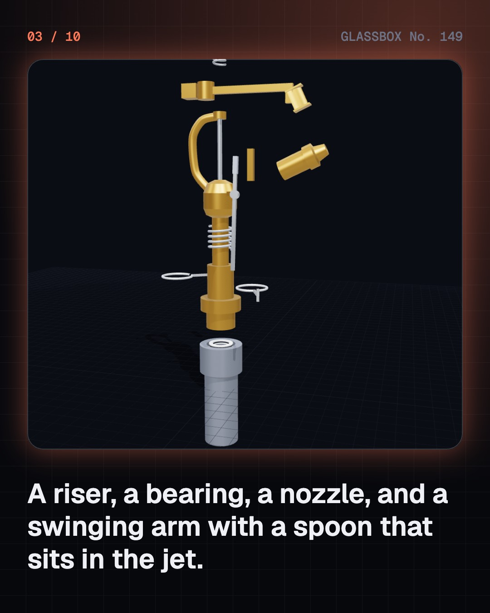
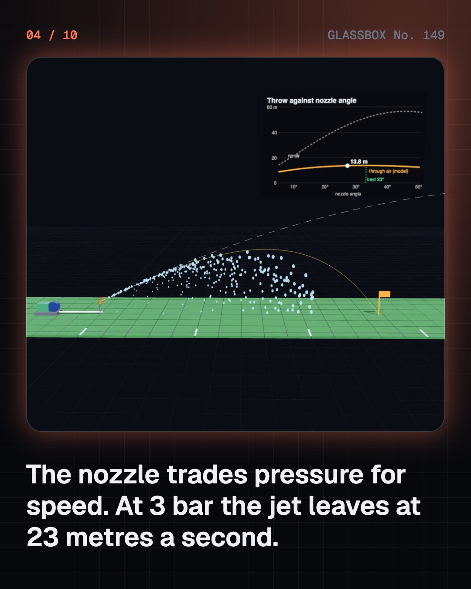

<!-- glassbox:start -->
<!-- Generated from glassbox.json by the Glassbox hub (npm run readme -- sprinklerclear). Edit glassbox.json, not this block. -->
<p align="center"><a href="https://glassbox.how/e/sprinklerclear/"></a></p>

<h1 align="center">SprinklerClear</h1>

<p align="center"><b>How does a water sprinkler work?</b><br>The tick-tick-tick sprinkler has no motor: its own jet throws an arm aside, a spring swings it back, and every tap turns the head three degrees. Watch that happen in slow motion, see why sprinklers must overlap, and find out why a fire sprinkler never sets off its neighbours.</p>

<p align="center"><a href="https://glassbox.how/sprinklerclear/"><b>▶ Play with it</b></a> &nbsp;·&nbsp; <a href="https://glassbox.how/e/sprinklerclear/">Read the 60-second explainer</a> &nbsp;·&nbsp; <a href="https://glassbox.how/sprinklerclear/glassbox/reel.mp4">Watch the 40-second video</a></p>

<p align="center">
  <a href="https://glassbox.how/e/sprinklerclear/"></a>
  <a href="https://glassbox.how/e/sprinklerclear/"></a>
  <a href="LICENSE"></a>
  <a href="LICENSE-CONTENT.md"></a>
  <a href="#privacy"></a>
</p>

## In 60 seconds

1. **No motor, just water.** An impact sprinkler is a riser pipe, a bearing the head turns in, a nozzle tilted up at about 25 degrees, and a spring-loaded arm with a spoon that sits in the jet. Water pressure also squeezes a stack of washers in the bearing, which seals it and gives the friction that holds the head still between taps.
2. **Pressure becomes speed, and air decides the throw.** The nozzle turns pressure into speed: v = 0.96 × √(2P/ρ), about 23.6 m/s at 3 bar, the push of a tank 31 m up. With no air that jet would land 47 m away. Drag on the drops cuts it to about 14 m, and makes the best angle about 33 degrees, not 45.
3. **Tick: the arm strikes the body.** The jet hits the spoon and flings the arm aside. A spring swings it back and it strikes the anvil on the body, sharing its momentum with the head, which steps round about 3 degrees. That happens about 2.5 times a second. At the end of the arc a trip lever raises a tab, and blows on the tab chatter the head quickly back.
4. **One sprinkler waters badly, many water well.** A single sprinkler puts down most of its water close in and little at the rim. Set on a grid about half a wetted width apart, neighbours fill each other in. Christiansen's 1942 coefficient of uniformity scores the evenness: 12 m spacing at 3 bar gives about 90% in this model, and 1 bar leaves dry-centred doughnuts.
5. **Flood, sprinkler or drip.** To get the same water to the roots you pump need ÷ efficiency. FAO's guide figures are 60% for flood, 75% for sprinklers and 90% for drip; India's ICAR puts ordinary flood irrigation at only 30 to 50%. For a crop using 5 mm a day on one hectare, that is 83,000 litres by flood against 56,000 by drip.
6. **The fire sprinkler is a different machine.** Each fire sprinkler head is a valve held shut by a glass bulb of liquid that shatters at its rated temperature, 68 °C for a red bulb. Every head feels only its own heat, so only those over the fire open: one head was enough in 77% of the fires NFPA counted where sprinklers operated.

## Words worth knowing

| Term | Meaning |
|---|---|
| **Impact sprinkler** | A sprinkler turned by a spring-loaded arm that its own jet throws aside and that strikes the body on its return. |
| **Nozzle** | A smooth narrowing that turns water pressure into speed: v = C × √(2P/ρ), with C about 0.96. |
| **Pressure head** | Pressure written as a height of water: about 0.1 bar for every metre. |
| **Radius of throw** | How far from the sprinkler its farthest drops land. Air drag on the drops sets it. |
| **Trip lever and collars** | The lever that flips at each end of the arc and makes a part-circle sprinkler turn back. |
| **Coefficient of uniformity (CU)** | Christiansen's score for even watering: 100 × (1 − average miss ÷ average depth). 100% is perfectly even. |
| **Application rate** | How fast water is put on the ground, in millimetres an hour. One millimetre is one litre on every square metre. |
| **Field application efficiency** | The share of the water put on a field that ends up where roots can use it. |
| **Glass bulb** | The liquid-filled capsule that props a fire sprinkler shut and shatters at a set temperature. |

## A short history

**2,000 years from a steam toy that spun in Alexandria to circles of green you can see from an aeroplane.**

- **60** · A ball that spins on its own steam (Hero of Alexandria, Alexandria, Egypt)
- **1871** · A patent for watering the lawn (Joseph Lessler, Buffalo, New York, USA)
- **1874** · A sprinkler that opens by itself (Henry S. Parmelee, New Haven, Connecticut, USA)
- **1881** · Grinnell makes it dependable (Frederick Grinnell, Providence, Rhode Island, USA)
- **1933** · The sprinkler that goes tick, tick, tick (Orton Englehart, Glendora, California, USA)
- **1942** · A number for evenness (J. E. Christiansen, University of California, USA)
- **1952** · A pipe that walks in a circle (Frank Zybach, Strasburg, Colorado, USA)
- **2015** · Per Drop More Crop (Government of India, India)

The full story, with 30 moments, charts, people and 46 sources: [glassbox.how/e/sprinklerclear/history](https://glassbox.how/e/sprinklerclear/history/). The data lives in [`history.json`](history.json).

## Video and slides

Made with the Glassbox studio from this box's storyboard (`window.glassbox.director`). Free to reuse under CC BY 4.0.

<a href="https://glassbox.how/sprinklerclear/glassbox/video.mp4"></a>

<p><a href="glassbox/slide-1.jpg"></a> <a href="glassbox/slide-2.jpg"></a> <a href="glassbox/slide-3.jpg"></a> <a href="glassbox/slide-4.jpg"></a></p>

| File | What | Size |
|---|---|---|
| [`glassbox/reel.mp4`](https://glassbox.how/sprinklerclear/glassbox/reel.mp4) | Reel / Short, with captions and soundtrack | 1080×1920 |
| [`glassbox/video.mp4`](https://glassbox.how/sprinklerclear/glassbox/video.mp4) | YouTube video, with captions and soundtrack | 1920×1080 |
| `glassbox/slide-1…10.jpg` | Instagram carousel | 1080×1350 |
| `glassbox/thumb.jpg` | YouTube thumbnail | 1280×720 |
| `glassbox/cover.jpg` | Share card and repo social preview | 1200×630 |
| [`glassbox/history-reel.mp4`](https://glassbox.how/sprinklerclear/glassbox/history-reel.mp4) | “History in 10 moments” Reel / Short | 1080×1920 |
| `glassbox/history-slide-*.jpg` | History carousel | 1080×1350 |
| `glassbox/post.json` | Post copy and schedule used by the publish kit | |

## Privacy

This box has no accounts and no ads, and it ships its own fonts and libraries. When you run it yourself it sends nothing anywhere. On glassbox.how, the site's `/bar.js` also loads Glassbox's analytics: **Google Analytics** to count visits (it asks first in the EU, UK and Switzerland, and stays off when your browser sends Global Privacy Control or Do Not Track) and **ClickTrust** to detect bots.

It remembers a few things **in your own browser only**, and never sends them anywhere:

| Browser storage key | What it holds |
|---|---|
| `sprinklerclear.v1` | Which chapters you have opened, your best quiz scores, and sound on or off. |

Exactly what each one sees is at [glassbox.how/privacy](https://glassbox.how/privacy/).

## Licences

- **Code:** [MIT](LICENSE). Use it, change it, ship it.
- **Explanations, text, images and videos** (`glassbox.json`, `glassbox/`): [CC BY 4.0](LICENSE-CONTENT.md). Credit “Glassbox, glassbox.how/e/sprinklerclear”.
- **Third-party parts** keep their own licences: [three.js](https://threejs.org) (MIT), [Geist, Instrument Serif](https://openfontlicense.org) (SIL OFL 1.1).
- The Glassbox name and logo aren't covered by either licence. See the [terms](https://glassbox.how/terms/).

Found a mistake? [Open an issue](https://github.com/bdeeps/sprinklerclear/issues). Corrections happen in public.
<!-- glassbox:end -->

## Run it

It's plain HTML, CSS and JavaScript. No build step and no dependencies. Run locally, it contacts no other website.

```bash
python3 -m http.server 8000
```

Three.js and the fonts ship in `vendor/` and `fonts/`, so it also works offline.

Then open http://localhost:8000.

## How it's built

| File | What |
|---|---|
| `index.html`, `css/app.css` | The page and its styles |
| `js/app.js`, `js/stage.js`, `js/ui.js`, `js/kit.js` | The shared Glassbox 3D engine: chapters, 3D stage, controls, quiz, video director |
| `js/sprinkler.js` | The physics, with no drawing in it: nozzle, drops flying through air, one sprinkler's footprint, the field map and Christiansen's CU, the impact-drive simulation, the water budget and the fire-sprinkler heat model |
| `js/parts.js` | Shared drawing kit: the impact sprinkler model, chart boards, turned parts, flying drops |
| `js/chapters/*.js` | One file per chapter: the 3D model, controls, text, key terms, quiz and video scenes |
| `glassbox.json` | Title, question, explainer beats, key terms, browser storage and credits shown on glassbox.how |
| `reel` in each chapter | The storyboard the Glassbox studio records into short videos |
| `glassbox/` | The published video, slides, thumbnail and post copy |
| `fonts/`, `vendor/three/` | Self-hosted Geist and Instrument Serif (SIL OFL 1.1) and three.js (MIT) |
